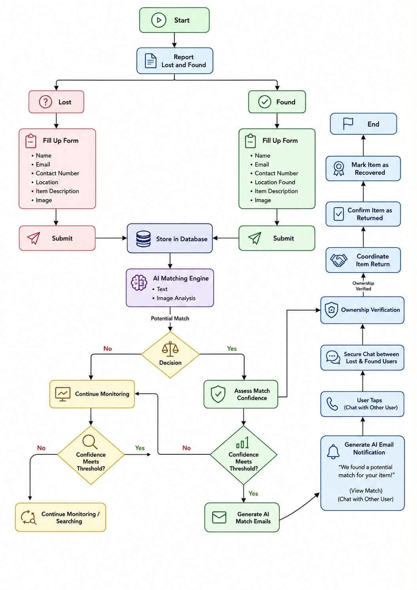

# SJC Campus Lost & Found

A Progressive Web App (PWA) for reporting and recovering lost items at Saint Jude College Manila (PHINMA Education).

## Overview

SJC Campus Lost & Found is a full-stack web application designed to streamline the process of reporting, searching, and recovering lost belongings within the campus community. The system features AI-assisted item matching, real-time notifications, secure in-app messaging, an offline-first capability, and a secure OTP-based password recovery system.

## Key Features

- **User Authentication** — PHINMAEd email-based sign-up with role-based access (user / admin)
- **Secure Password Reset (OTP)** — Forgot password flow using a 6-digit email OTP with a 10-minute expiration.
- **Item Reporting** — Report lost or found items with images, category, location, and description
- **AI-Assisted Matching** — Hybrid matching engine using text similarity and perceptual image hashing
- **Real-Time Notifications** — Instant updates powered by PocketBase realtime subscriptions
- **In-App Messaging** — Secure user-to-user chat and admin inquiry threads
- **Admin Dashboard** — Verify reports, review ownership claims, and manage items with an AI-driven matching interface
- **Offline-First** — Submit reports, claims, and messages offline; automatic sync when connected
- **Progressive Web App** — Installable on mobile devices

## System Roles & User Registration Rules

To maintain data integrity and security within the campus, the system strictly enforces the following rules for users:

1. **User Role (Students, Faculty, Staff):** 
   Any individual with a valid `@phinmaed.com` email address can register as a User. This includes students and regular faculty members. They are authorized to report lost/found items, browse the database, and submit claims.
   
2. **Admin Role (SJC Office / Student Affairs):** 
   Administrative access is not given to regular teachers. The Admin role is specifically assigned to the designated office managing the Lost & Found (e.g., Student Affairs Office or Security Office). They handle report verification, claim approvals, and manage the AI matching engine.
   
3. **Non-PHINMAEd Personnel (e.g., Janitors, Security Guards):** 
   Since account creation requires a PHINMAEd email, non-academic staff cannot create direct accounts. If a janitor or guard finds an item, they must physically surrender it to the SJC Office. The Admin will file the report on their behalf using the Admin dashboard to ensure the item enters the database and gets processed by the AI.

## Infrastructure & Hosting Architecture (For UML)

Para malinaw sa UML Diagrams ninyo (Use Case at Sequence), heto ang exact hierarchy ng backend:

1. **Wisbyte (Cloud Hosting Provider):** The external cloud server where the backend is deployed. It provides the public URL (e.g., `sjc-lostfound.wisp.uno`) and ensures the system is accessible online.
2. **PocketBase (Backend Application):** Runs inside the Wisbyte server. It acts as the API layer, handling authentication, real-time WebSockets, file storage, and custom JS hooks (for OTP).
3. **SQLite (Main Database):** The relational database engine managed by PocketBase. All persistent data (users, items, matches, messages) are stored here.
4. **IndexedDB (Local Offline Database):** A browser-based storage used by the frontend. When a user is offline, reports and messages are saved here temporarily and synced to SQLite once the connection returns.

## AI Matching & Notification Flow (For UML Sequence Diagrams)

Kapag gagawa kayo ng Sequence Diagram, heto ang tamang flow ng AI Matching:

1. **Admin Trigger:** The Admin clicks the "Run AI Match" button (or verifies a newly submitted item).
2. **AI Computation:** The frontend sends image URLs to the Python Flask microservice, which computes the similarity score.
3. **Database Update:** If the score meets the threshold, the system saves the result to the `matches` collection. Simultaneously, it creates a record in the `notifications` collection.
4. **Real-Time Notification:** Because the user is connected via WebSockets, the UI instantly updates. A red badge appears on the **In-App Notification Bell** (top navigation bar), and a new alert appears on the **Notifications Page**.
5. **User Action:** The user can view the match in the **"AI Potential Matches"** panel on the Items page. Clicking "Confirm" automatically creates a conversation and redirects them to the **Messages Page** to coordinate the item return.

## System Flowchart

The following diagram illustrates the end-to-end process of the SJC Campus Lost & Found system.

## Tech Stack

| Layer | Technology |
|-------|------------|
| Frontend | Vite + TypeScript + Vanilla HTML/CSS |
| Backend | PocketBase (SQLite + realtime subscriptions + Custom JS Hooks) |
| AI / Image Service | Python Flask + Pillow + ImageHash |
| Offline Storage | IndexedDB (via idb) |
| PWA | Service Worker + Web Manifest |
| Deployment | Vercel (frontend) + Wisbyte (PocketBase backend) + Cloudflare Tunnel (AI service) |

## Project Structure

    lost-and-found/
    ├── public/                  Static assets
    ├── src/                     TypeScript source
    │   └── offline/             Offline-first engine
    ├── python-service/          AI image similarity microservice
    ├── pocketbase/              PocketBase binary + pb_hooks + migrations
    ├── index.html               Landing page
    ├── items.html               Browse items
    ├── report.html              Report form
    ├── messages.html            In-app chat
    ├── notifications.html       Notifications
    ├── admin.html               Admin dashboard
    ├── flowchart.jpg            System process diagram
    ├── package.json
    ├── tsconfig.json
    ├── vite.config.ts
    └── vercel.json

## Quick Start

### Prerequisites

- Node.js 18+
- Python 3.10+
- PocketBase binary

### Install dependencies

    npm install
    pip install -r python-service/requirements.txt

### Configure environment

Copy .env.example to .env.local:

    VITE_PB_URL=http://localhost:8090
    VITE_MATCHER_URL=http://localhost:5000

### Start all services

Terminal 1 — PocketBase:

    cd pocketbase
    ./pocketbase serve

Terminal 2 — Python AI service:

    cd python-service
    # Windows: .venv\Scripts\activate
    # Mac/Linux: source .venv/bin/activate
    python app.py

Terminal 3 — Vite dev server:

    npm run dev

Open http://localhost:5173

## Architecture & Data Flow

**Client:** Vite + TypeScript multi-page application.
**Backend:** PocketBase provides SQLite database, REST API, and realtime WebSocket API.
**AI Image Service:** Python Flask microservice. Returns a similarity score using perceptual hashing.
**Offline Engine:** Custom IndexedDB layer with wrappers, queue, sync, and indicator modules.

### Data Flow — Report Submission
1. User fills report form.
2. If online: POST to PocketBase items. If offline: save to IndexedDB queue.
3. On online event: replay queue, POST to PocketBase.
4. Realtime event notifies all subscribers.
5. AI matcher runs (if triggered by admin).
6. Matches saved to `matches` collection.
7. Notifications sent to affected users.

### Data Flow — Ownership Claim
1. User clicks "Claim This Item" and submits proof.
2. Admin dashboard notified (realtime).
3. Admin reviews and approves.
4. System marks item as recovered.
5. Conversation created between owner and claimant.
6. User notified, chat unlocked.

### Data Flow — Password Reset (OTP)
1. User enters PHINMAEd email in Forgot Password.
2. Frontend sends POST to `/request-otp`.
3. Backend generates OTP, saves to `otp_codes` with 10-min expiration.
4. OTP sent via SMTP.
5. User enters OTP and new password.
6. Frontend sends POST to `/verify-otp`.
7. Backend validates OTP, updates password, deletes OTP.

## Database Schema

Database is managed by PocketBase (SQLite). Nine collections.

### users
| Field | Type | Notes |
|-------|------|-------|
| id | text | PK |
| email | email | unique, @phinmaed.com |
| password | password | hashed |
| fullname | text | display name |
| avatar | file | optional |
| role | select | user or admin |

### items
| Field | Type | Notes |
|-------|------|-------|
| id | text | PK |
| userId | text | FK users.id |
| userName | text | denormalized |
| userEmail | text | denormalized |
| itemName | text | required |
| category | select | gadgets/books/ids/wallets/keys/clothing/documents/others |
| location | text | required |
| description | text | required |
| status | select | lost/found/pending |
| date | datetime | when lost/found |
| verified | bool | admin-verified |
| recovered | bool | returned to owner |
| images | file array | max 5 |

### claims
| Field | Type | Notes |
|-------|------|-------|
| id | text | PK |
| itemId | text | FK items.id |
| itemName | text | denormalized |
| userId | text | FK users.id |
| userName | text | required |
| userEmail | text | required |
| contactNumber | text | required |
| proof | text | ownership proof |
| status | select | pending/approved/rejected |
| adminNote | text | nullable |
| reviewedBy | text | nullable |

### notifications
| Field | Type | Notes |
|-------|------|-------|
| id | text | PK |
| userId | text | FK users.id |
| itemId | text | FK items.id |
| message | text | required |
| read | bool | default false |

### conversations
| Field | Type | Notes |
|-------|------|-------|
| id | text | PK |
| itemId | text | required |
| itemName | text | required |
| user1Id | text | FK users.id |
| user1Name | text | required |
| user2Id | text | FK users.id |
| user2Name | text | required |
| lastMessage | text | preview |
| hiddenFor | text array | user ids who hid thread |

### messages
| Field | Type | Notes |
|-------|------|-------|
| id | text | PK |
| conversationId | text | FK conversations.id |
| senderId | text | FK users.id |
| senderName | text | required |
| receiverId | text | FK users.id |
| text | text | required |
| read | bool | default false |

### admin_messages
| Field | Type | Notes |
|-------|------|-------|
| id | text | PK |
| userId | text | FK users.id |
| userName | text | required |
| userEmail | text | required |
| itemId | text | FK items.id |
| itemName | text | required |
| senderRole | select | user or admin |
| text | text | required |
| read | bool | default false |

### matches
| Field | Type | Notes |
|-------|------|-------|
| id | text | PK |
| lostItemId | text | FK items.id |
| foundItemId | text | FK items.id |
| confidenceScore | number | 0 to 100 |
| matchReason | text | explanation |
| status | select | pending/confirmed/rejected/completed |

### otp_codes
| Field | Type | Notes |
|-------|------|-------|
| id | text | PK |
| email | text | user's email |
| code | text | 6-digit OTP |
| expiresAt | datetime | 10 minutes from generation |

## Offline-First Feature

### Why Offline-First
Campus WiFi is often unreliable. Without offline support, user work is lost when connectivity drops.

### How It Works
All write operations go through a wrapper. If online, the API is called directly. If offline, the operation is enqueued in IndexedDB. A sync engine listens for the online event and replays the queue in order.

### Sync Triggers
- window.online event
- window.focus event
- visibilitychange event
- Every 5 seconds (background check)
- 500ms after page load

## Expected Outcomes

1. **Faster Item Recovery:** Because of the AI Matching Engine, the chances of finding the owner or the lost item are higher and faster compared to manual Facebook group posting.
2. **Centralized System:** Magkakaroon ng iisang platform ang SJC community para sa Lost & Found.
3. **Data Privacy:** Legit students, faculty, at staff lang ng SJC ang makakagamit ng system dahil sa PHINMAEd email restriction.
4. **Operational Efficiency for Admin:** Mas madali para sa SJC office ang mag-track at mag-manage ng mga reported items.

## Q and A na nahula hula lang

ito lang ung possibilities na itatanong, 50/50 lang I'm not sure tlga to, but ito lang makakatulong if ever -developer

**Q1: Since required ang PHINMAEd email sa system, paano po ninyo hinahandle yung mga reports galing sa janitor o security guard na walang ganung email?**
*   **A:** *"Since hindi sila makakagawa ng direct account, ang protocol po natin is ibibigay nila physically yung item sa SJC Office. Then, ang Admin po ang magre-report non sa system on their behalf. This ensures na lahat ng nahanap na gamit ay pumapasok sa database at na-a-analyze ng AI matching engine, kahit sino pa ang nakakita."*

**Q2: Sino po ba exactly ang may hawak ng Admin role? Kasama po ba ang mga teachers doon?**
*   **A:** *"Hindi po. Ang mga teachers ay naka-register under 'User' role lang, same as students. Yung 'Admin' role po ay exclusive lang sa SJC Office or Student Affairs. Sila po yung authorized mag-verify ng reports, mag-run ng AI match, at mag-approve ng mga claims."*

**Q3: Kapag po may nahanap na match yung AI, paano po nalalaman ng user? Saan po pumupunta yung notification?**
*   **A:** *"Real-time po ito dahil gumagamit tayo ng PocketBase WebSockets. Pagka-save ng AI ng match sa database, sabay po siyang nag-ge-generate ng notification. Agad po siyang mag-aappear sa user—magkakaroon ng red badge yung Notification Bell icon nila at may match card sa Items page. Hindi na po nila kailangang i-refresh yung page."*

**Q4: Para po sa UML ninyo, paano po ninyo iki-clarify yung difference ng Wispbyte, PocketBase, at SQLite sa infrastructure niyo?**
*   **A:** *"Yung Wispbyte po yung cloud hosting provider natin—sila yung server. Yung PocketBase po yung backend application na tumatakbo sa loob ni Wispbyte, siya yung humahawak ng API at WebSockets. Tapos yung SQLite po yung mismong database engine kung saan naka-save lahat ng data. Sa frontend naman po, may IndexedDB tayo para gumana yung offline mode."*

**Q5: Sa UML Sequence Diagram ninyo, paano po nire-represent yung AI Matching process?**
*   **A:** *"Sa diagram po, ang flow is: Admin triggers 'Run AI Match' -> Frontend calls Python AI Microservice -> Python computes the image similarity -> PocketBase saves sa matches at notifications database -> User receives the alert via WebSockets."*

**Q6: Bakit po walang 'Delete' button sa Admin Dashboard?**
*   **A:** *"Sadya po naming tinanggal ang delete button para mapanatili ang data integrity. Kailangan ng AI matching algorithm na may complete historical dataset para maging accurate yung image analysis. Imbes na i-delete, gumagamit kami ng statuses tulad ng 'Verified' o 'Recovered' para may proper audit trail."*

## Team ArkNights

| Role | Member |
|------|--------|
| Leader / UI Designer | Quintela, Addriane Zhermielle |
| Developer | Asuncion, JohnMarc F. |
| UI Designer | Talusan, Moschin Kunday |
| Documentation | Taladro, Greg Martin |
| Documentation | Osinsao, Camille |

**Institution:** Saint Jude College Manila — PHINMA Education
**School Year:** 2025–2026

## License

Academic project — Saint Jude College Manila. All rights reserved.